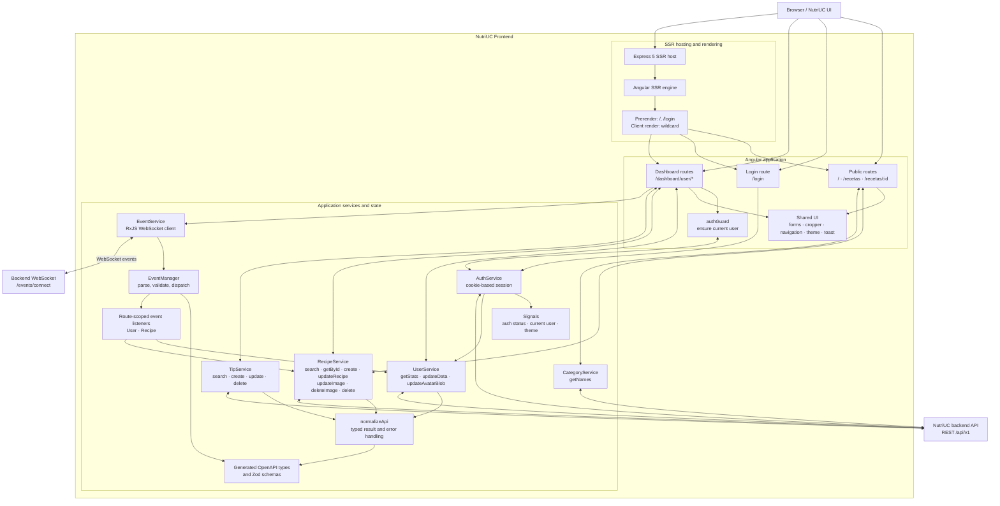

# NutriUC Frontend Architecture

> [!NOTE]
> **Work in progress:** this document describes the frontend implementation in this repository. Backend internals are outside its scope.

## Overview

The frontend is an Angular 22 application built from standalone, lazy-loaded route components. It uses Angular Signals for local and shared reactive state, RxJS for HTTP and event streams, and generated TypeScript definitions from the backend OpenAPI schema.

The application is hosted by Express through Angular SSR. The server prerenders `/` and `/login`; the wildcard server route uses client rendering. Browser and server providers are merged in `app.config.server.ts`. The API base URL is provided through the `API_URL` injection token: development uses `http://localhost:3000/api/v1`, while production uses `/api/v1`.

## Frontend architecture diagram

## Main building blocks

### Routing and rendering

- Public pages are grouped under `PublicLayout`: home, recipe search, and recipe detail.
- `/login` is a standalone route.
- `/dashboard/user/*` is protected by `authGuard` at the dashboard parent and child route levels. The guard calls `AuthService.ensureCurrentUser()` and redirects unauthenticated users to `/login`.
- Dashboard child pages cover the user home, profile and profile editing, personal creations, recipe listing/creation/detail/editing, and tips.
- Route components are loaded lazily. User and recipe event listeners are provided at their corresponding route scopes.
- `app.routes.server.ts` prerenders only the root and login routes. Other URLs use `RenderMode.Client`.

### API and authentication

- `API_URL` is injected into `AuthService`, `UserService`, `RecipeService`, `TipService`, and `CategoryService`.
- API request and response types are derived from the generated OpenAPI schema in `src/app/types/api/schema.d.ts`.
- `normalizeApi` converts HTTP success and error outcomes into a typed result shape for API services.
- Authenticated calls opt into `withCredentials: true`; the frontend relies on HTTP-only cookies and does not keep JWTs in browser storage.
- Recipe and tip search accept cursor, direction, limit, name, category, and optional `mine` parameters. Image and avatar uploads use `FormData`; recipe/avatar cropping is handled in the browser with Cropper.js elements.

### WebSocket events

The dashboard layout connects `EventService` on construction and disconnects it when destroyed. The service derives `/events/connect` from `API_URL`, switches the URL scheme from HTTP(S) to WS(S), and consumes messages with `rxjs/webSocket`. `EventManager` parses and validates each message, then dispatches known user, recipe, and server events or routes unknown events to the unknown channel. User and recipe listeners are registered with the corresponding route providers.

### State and shared UI

Angular Signals hold authentication status, the current user, theme state, and event connection status. Shared components provide navigation, recipe cards and forms, image cropping, theme selection, and toast notifications. Zod schemas validate event and domain data at runtime where used.

## Runtime and dependencies

| Area                     | Current dependency/configuration                                    |
| ------------------------ | ------------------------------------------------------------------- |
| Angular                  | Angular packages `^22.1.0`; CLI/build `^22.1.6`                     |
| SSR                      | `@angular/ssr` `^22.2.0`, Express `^5.1.0`                          |
| HTTP and reactivity      | Angular `HttpClient`, RxJS `~7.8.0`; WebSocket via `rxjs/webSocket` |
| Styles                   | Tailwind CSS `^4.1.12`, `@tailwindcss/postcss` `^4.1.12`            |
| UI                       | `@lucide/angular` `^1.48.0`, `ngx-sonner` `^3.1.0`                  |
| Cropper                  | `@cropper/element-*` packages `^2.3.1`                              |
| Validation and API types | Zod `^4.6.5`, `openapi-typescript` `^7.13.0`                        |
| Package manager          | Bun `1.4.0`                                                         |
| Unit testing             | Vitest `^4.0.8`, JSDOM `^28.0.0`, Angular unit-test builder         |

Refer to `package.json` and `angular.json` for the full dependency list and build configuration.
